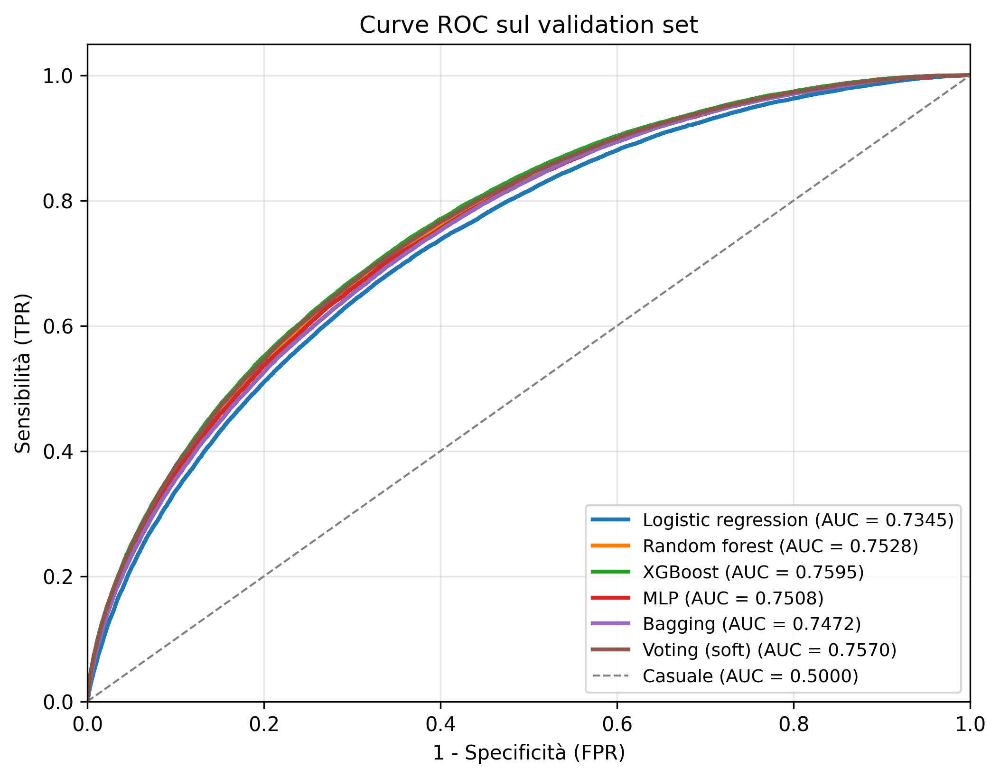
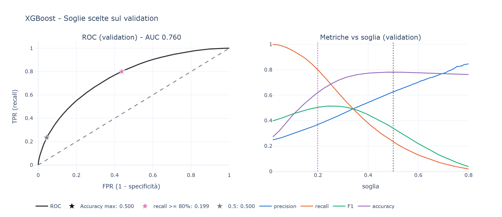
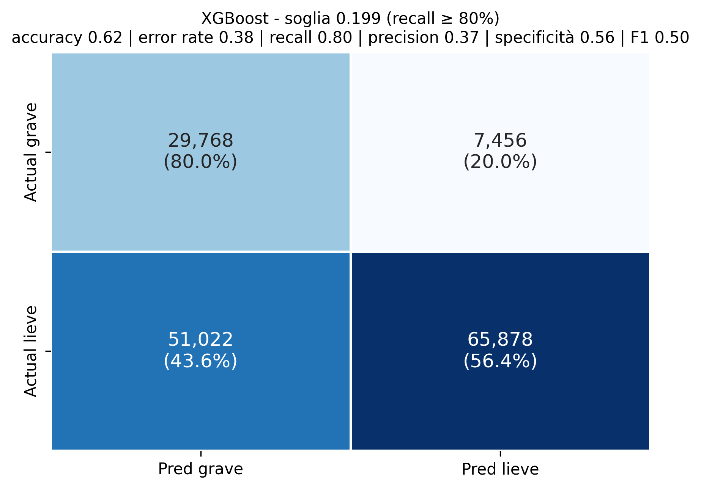
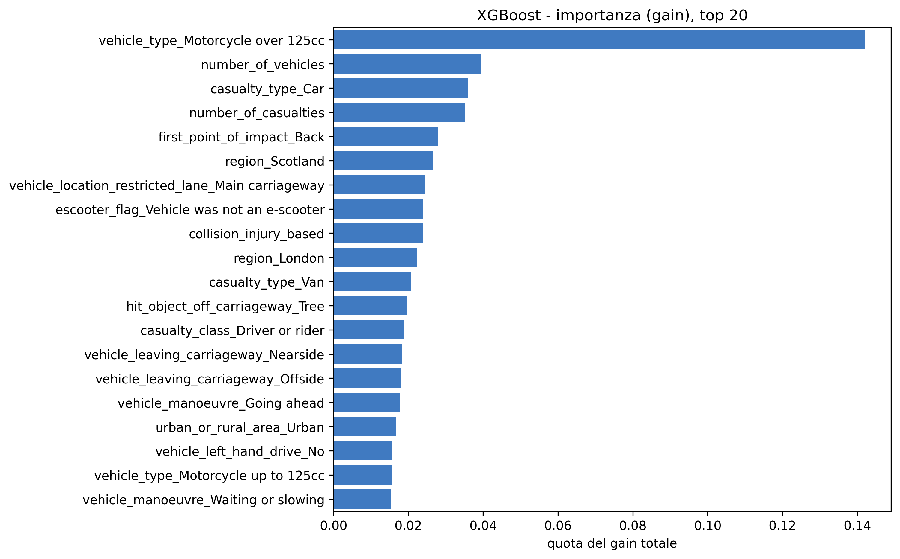

# Mind the Crash

Classifying the severity of road collisions in the United Kingdom with STATS19 data (2021–2025).

Group project for the *Statistical Modelling and Machine Learning* course.

**[Try the live demo →](https://joanacurri.github.io/mind-the-crash-github/take-a-call.html)**

## Goal

We put ourselves in the shoes of the emergency call centre: when the call comes in, someone has to decide how much help to send without knowing how serious the collision is. The model estimates whether a collision is **serious** (Fatal + Serious) or **slight**, using only the information the caller can give straight away. The error to avoid is classifying a serious collision as slight.

## Results

| | |
|---|---|
| Dataset | 513,745 collisions, 24.2% serious |
| Split | 70% training (359,621) / 30% test (154,124), stratified by week of the year |
| Variables | 40, selected out of 111 |
| Final model | XGBoost |
| Test AUC | 0.756 |
| Threshold | 0.221 (the highest with recall ≥ 75%) |
| Recall | 0.75 |
| Precision | 0.38 |
| Specificity | 0.62 |
| Accuracy | 0.65 |

Model comparison on the test set:

| Model | Train AUC | Test AUC | Overfitting |
|---|---|---|---|
| XGBoost | 0.781 | 0.756 | no |
| Voting (soft) | 0.783 | 0.753 | no |
| Random forest | 0.825 | 0.750 | yes |
| MLP | 0.763 | 0.746 | no |
| Bagging | 0.784 | 0.744 | no |
| Logistic regression | 0.724 | 0.724 | no |

At the chosen threshold the model recognises 3 serious collisions out of 4 and flags 47% of calls as serious. The variable that weighs most is the presence of a motorcycle over 125cc, followed by casualties in cars, the number of casualties and the number of vehicles.









## How it works

| Notebook | What it does |
|---|---|
| [`01_Analysis.ipynb`](01_Notebooks/01_Analysis.ipynb) | Reads the three STATS19 tables (collisions, vehicles, casualties), drops identifiers and variables known only after the collision, decodes the codes, one-hot encodes and aggregates everything to one row per collision |
| [`02_Preprocessing.ipynb`](01_Notebooks/02_Preprocessing.ipynb) | Drops correlated (\|r\| ≥ 0.85) and near-constant variables, builds the target, splits into training and test, imputes missing age with the training median |
| [`03_Variable_selection.ipynb`](01_Notebooks/03_Variable_selection.ipynb) | Ranks the variables with a Random Forest inside a 5-fold cross-validation and chooses how many to keep by looking at the ASE |
| [`04_Models.ipynb`](01_Notebooks/04_Models.ipynb) | Tuning and comparison of six models, overfitting check, threshold choice, variable importance, scoring |

Section headings in the notebooks are in English; code comments, printed messages and chart labels are in Italian.

## Structure

```
00_Data/          data (large files are downloaded: see 00_Data/README.md)
01_Notebooks/     the four notebooks, to run in order
02_Figures/       charts produced by the notebooks
03_Presentation/  project slides (English and Italian)
04_Dashboard/     call simulator and analysis pages
Technical_docs/   notes on saving and loading the models
```

## How to run it

1. Install the libraries (Python 3.12):
   ```
   pip install -r requirements.txt
   ```
2. Download the three Department for Transport CSVs as described in [`00_Data/README.md`](00_Data/README.md).
3. Run the notebooks in order from `01` to `04`, opening them from the `01_Notebooks` folder (paths are relative). The tuning in notebook 04 is the slow part; the notes in [`Technical_docs/`](Technical_docs/04_Models_saving_and_loading.md) explain how to restart from the saved models.

## Dashboard

Try it online: **[live demo](https://joanacurri.github.io/mind-the-crash-github/take-a-call.html)**.

Four pages: the simulator for the call handler, how the threshold works, what weighs most in the estimate, and the map of where collisions turn serious. The model runs in the browser and gives the same probabilities as the Python model.

To run it locally:

- **Windows:** double-click `04_Dashboard/Open the simulator.bat`
- **Mac/Linux:** `python3 04_Dashboard/serve.py`

Only Python is needed, no packages. Details in [`04_Dashboard/README.md`](04_Dashboard/README.md), choices and assumptions in [`04_Dashboard/ASSUMPTIONS.md`](04_Dashboard/ASSUMPTIONS.md).

The dashboard is a teaching demo: it is not an official service and the operational guidance does not come from the model.

## Limitations

- The dataset only contains collisions recorded by the police, not all calls: in production the probabilities would need recalibrating on the real share of serious collisions.
- We did not use a cost matrix: the threshold is chosen on recall.

## Authors

Joana Curri · Mario D'Angelo · Edy Maria Delcane · Salvatore Zizzi

## Data

STATS19, Department for Transport (UK), [Open Government Licence v3.0](https://www.nationalarchives.gov.uk/doc/open-government-licence/version/3/).
